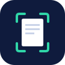

<h1 align="center">CropScan</h1>

<b>Crooked photo in. Flat scan out.</b> A free document scanner for Android. No ads, no account, no internet.

  <a href="https://play.google.com/store/apps/details?id=com.cropscan.app">Get it on Google Play</a> ·
  <a href="https://sergiupogor.github.io/cropscan-app/">Website</a> ·
  <a href="https://sergiupogor.github.io/cropscan-app/privacy.html">Privacy policy</a> ·
  <a href="https://sergiupogor.github.io/cropscan-app/terms.html">Terms of use</a>

---

Point your phone at a page. CropScan finds its edges, cuts away the table and straightens the page, so it looks like it came off a flatbed scanner.

## What it does

**Scanning**
- Live edge detection that works on light tables, busy desks and with a finger over a corner
- Auto-capture when the page is steady and sharp, plus a manual shutter
- Focus lock, tap to focus and a warning when a page looks blurry
- Batch scanning, gallery import and "Share to CropScan" from any app
- ID card mode (both sides on one page) and business cards straight to your contacts

**Clean pages**
- Perspective correction that keeps the page's real proportions
- Filters: Original, Auto, Grayscale, Black and white, No shadow
- Rotate, reorder and delete pages, sign and annotate

**Text, receipts and invoices**
- On-device text recognition, search inside your scans, copy or share as text
- Receipt tracker with monthly totals by category and a tax/VAT report
- Invoices to an editable table and a real Excel (.xlsx) file

**Organise and share**
- Folders, search, multi-select, merge
- Full-quality PDF, password-protected PDF, JPEG, ZIP or text
- One-tap sharing to Viber, Telegram, WhatsApp, Gmail, Outlook, Drive, Messenger and Signal
- App lock with fingerprint, face or PIN, and backup and restore to a file you choose

## Privacy

CropScan doesn't request the internet permission, so Android itself keeps it offline. There's no account, no analytics and no ads. Your documents stay in the app's private storage until you share or export them. Read the [privacy policy](https://sergiupogor.github.io/cropscan-app/privacy.html).

## Free

No watermark, no ads, no page limits, no subscription to scan or export. The receipt tracker includes 10 receipts a month for free. If CropScan helps you, you can [support it on Ko-fi](https://ko-fi.com/mediapronet). Donations are optional and don't unlock anything.

## Help

Questions, bugs or ideas: [mediapronetsrl@gmail.com](mailto:mediapronetsrl@gmail.com)

Requires Android 7.0 or later. Made by MEDIAPRONET SRL, Republic of Moldova.

This repository hosts the CropScan website and legal pages. The app's source code is private.
